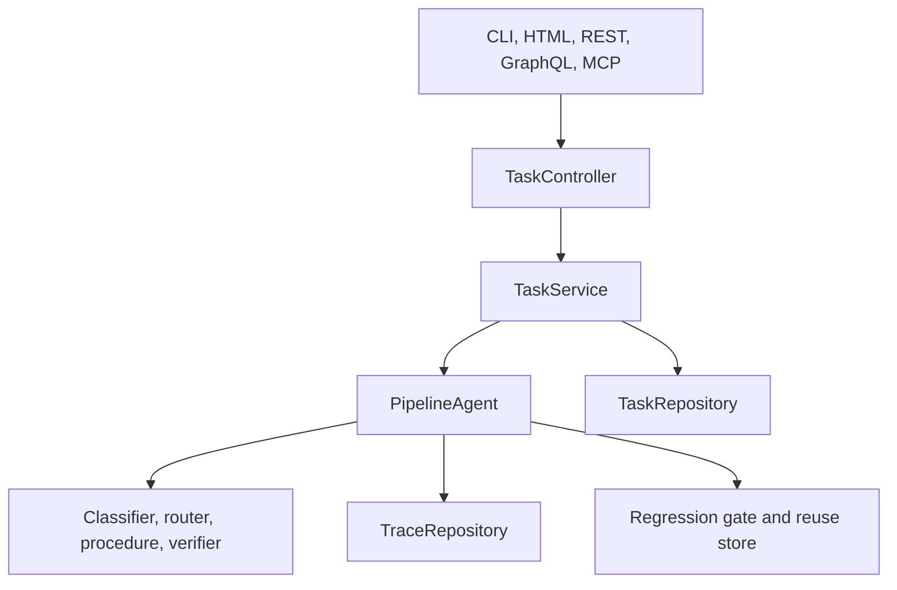

# AF Architecture

AF is a classification-heavy, inference-light Python framework. Its reference application
implements one execution pipeline and one Task application boundary, then adapts them to
CLI, HTML, REST, GraphQL, and MCP interfaces.

## Runtime flow

Every presentation adapter delegates to `TaskController`. Transport code translates input,
output, and expected errors; it does not implement classification, counting, verification,
reuse, or persistence rules.

## Composition root

`af.bootstrap.create_application()` is the composition root. It creates an explicit
`Container`, applies three service providers, and returns an `AFApplication` containing the
resolved settings and public runtime services.

The providers are:

1. `_PersistenceProvider`, which installs a `Database`, `TaskRepository`, and
   `TraceRepository`, or accepts injected repository test doubles.
2. `_FrameworkProvider`, which registers the built-in procedures, classifier chain,
   verifier, router, trace repository, regression gate, reuse store, and `PipelineAgent`.
3. `_ApplicationProvider`, which binds a singleton `TaskService` and transient
   `TaskController`.

The container uses explicit factories rather than constructor inspection or implicit
autowiring. `create_application()` also accepts replacement Task and trace repositories,
reuse storage, settings, and an optional model provider plus its verifier. The model and
verifier must be installed together; partial configuration fails during composition.

## Execution lifecycle

`TaskService.execute()` normalizes the prompt and passes a `WorkRequest` to
`PipelineAgent.handle()`. The agent then performs the AF lifecycle:

1. **Classify.** `ClassifierChain` tries `HelloClassifier`,
   `CharacterCountClassifier`, and finally `UnknownClassifier` in order.
2. **Route.** `LadderRouter` selects a compatible procedure from `ProcedureRegistry` using
   its tier and the active routing policy. The default policy optimizes for cheapest and
   fastest.
3. **Execute.** AF first looks in `ReuseStore`; a miss invokes the chosen procedure.
4. **Verify.** `VerifierRouter` sends static/procedural results to the independent
   `DeterministicVerifier` and sends a generative result only to its explicitly injected
   verifier.
5. **Record.** The pipeline builds an append-style trace containing the classification,
   route, output, verification result, and ordered lifecycle events.
6. **Test.** A pure, replay-safe result is executed again through
   `ReplayRegressionGate` before promotion.
7. **Reuse.** A passing result is promoted to the in-process reuse store. A later hit is
   independently verified again before return.

The completed trace is persisted after the lifecycle events have been assembled. Unknown
or unroutable prompts persist a shorter unsupported trace before raising `UnsupportedWork`.
Failed verification is also explicit and never becomes a successful outcome.

The initial registered capabilities are:

- `HelloProcedure`, a static route returning `Hello, world!`; and
- `CharacterCountProcedure`, a procedural route that counts one character with an explicit
  case-insensitive loop.

`ModelProcedure` defines an optional generative boundary. It is registered only when an
embedding host explicitly supplies both a `ModelProvider` and a `Verifier`. Generative
procedures are not pure or replay-safe, so their results are never promoted to the reuse
store. With no model pair installed, unsupported prompts fail closed; with a pair installed,
unknown work is executed and must pass that verifier before AF returns it.

## Task application boundary

`TaskController` is the shared MVC/application-facing controller. It delegates to
`TaskService`, which owns normalization, execution, and Task persistence semantics.

- `execute(prompt)` runs AF and persists a trace, but does not persist a Task.
- `create(prompt)` runs AF, then stores a new Task containing the verified outcome.
- `update(id, prompt)` loads the Task, re-executes the replacement prompt, and stores the
  new outcome while preserving the ID and creation time.
- `get`, `list`, and `delete` delegate to the Task repository.

A Task records its prompt, output, intent, route, tier, status, verification and reuse
flags, trace ID, and timestamps. It is separate from the append-style execution trace: one
Task can be updated to reference the trace of its latest execution.

## Persistence and reuse

The default application uses SQLAlchemy 2 with SQLite:

- `SqlAlchemyTaskRepository` stores Tasks in `af_tasks`.
- `SqlAlchemyTraceRepository` stores traces in `af_run_traces`.
- `Database` creates the schema and configures SQLite for the current process.

In-memory Task and trace repositories are available for isolated tests. Reuse currently
uses `InMemoryReuseStore`, so promoted results survive repeated calls within one application
process but not a process restart. Persistent Tasks and traces do not imply persistent reuse
cache entries.

## Transport adapters

| Adapter | Factory or entry point | Surface |
| --- | --- | --- |
| CLI | `af.interfaces.cli.create_cli()` | `af hello`, `af ask`, and `af tasks` CRUD |
| HTML MVC | `af.interfaces.web.create_web_router()` | Jinja Task pages and form actions |
| REST | `af.interfaces.rest.create_rest_router()` | `/api/v1/hello` and `/api/v1/tasks` CRUD |
| GraphQL | `af.interfaces.graphql.create_graphql_router()` | Task queries and mutations at `/graphql` |
| MCP | `af.interfaces.mcp.create_mcp_server()` | Eight `af_*` tools and `af://manifest` |

`af.interfaces.http.create_http_app()` combines HTML, REST, and GraphQL in one FastAPI
application and places the shared `AFApplication` on `app.state.af`. MCP is currently a
separate FastMCP process started with `af-mcp`; it is not mounted into the combined FastAPI
application. Both factories can receive the same already-composed `AFApplication` in tests
or an embedding host.

Each adapter owns only its transport types:

- CLI uses Typer and JSON presentation helpers.
- HTML uses FastAPI form controllers and Jinja templates.
- REST uses Pydantic request and response models.
- GraphQL uses Strawberry types and an injected controller context.
- MCP uses FastMCP tools, MCP safety annotations, and typed structured results.

This keeps transport behaviour replaceable while the `TaskController` and pipeline remain
the single implementation of AF's way of working.

## Package map

| Package | Responsibility |
| --- | --- |
| `af.framework` | Contracts, container, routing, execution pipeline, reuse, and shared values |
| `af.domain` | Classifiers, procedures, verification, Task model, and repository port |
| `af.application` | Task use cases and shared controller |
| `af.infrastructure` | SQLAlchemy database, Task repositories, and trace repositories |
| `af.interfaces` | CLI, HTTP, HTML, REST, GraphQL, MCP, and presentation mappings |
| `af/views` | Jinja templates and layouts |
| `af.bootstrap` | Providers, dependency composition, and `AFApplication` |
| `af.config` | Environment-backed runtime settings |

To add a deterministic capability, implement and test its classifier, procedure, and
independent verifier behaviour, register the procedure and classifier at the composition
root, and preserve the same application boundary. A new capability should not require each
transport to implement its logic independently.
